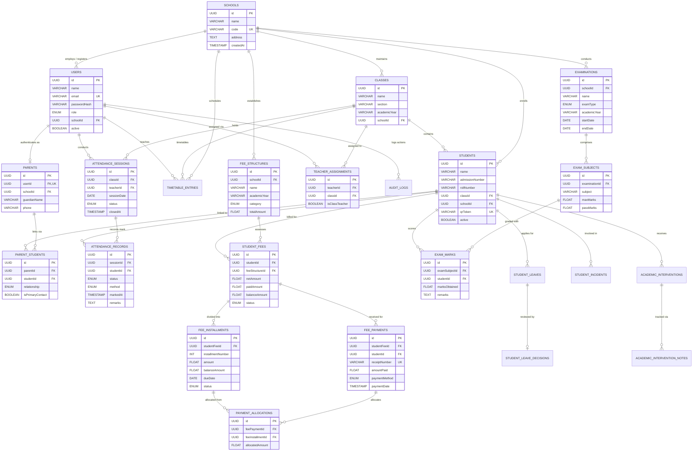
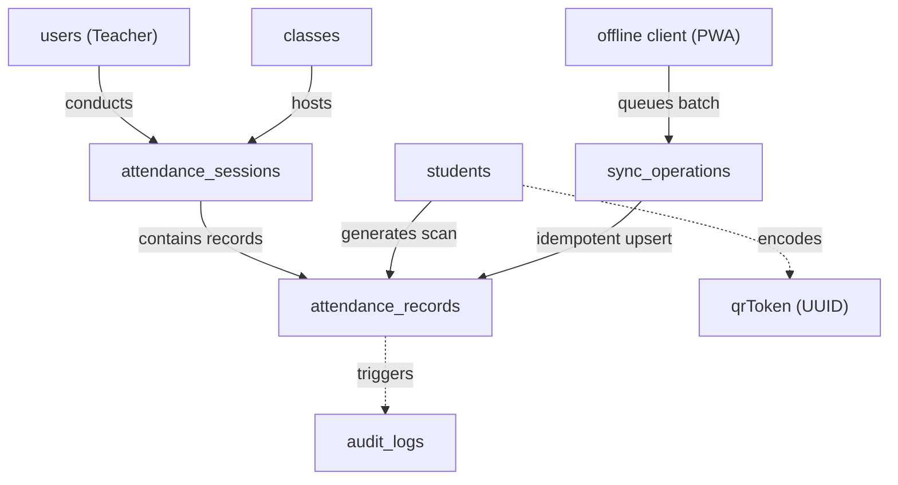
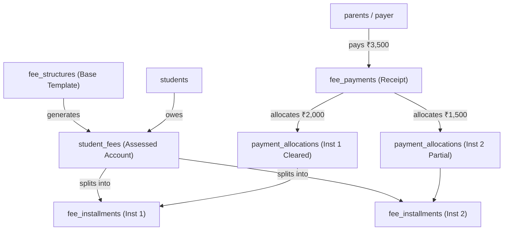

# 02. ER Diagram and Data Modelling
## Subject: Data Engineering (DE) – Section B
### Project: ShikshaTrack (Smart Attendance & School Management System)

---

## 1. Data Modelling Approach & Structural Overview

The data architecture of **ShikshaTrack** is structured using a fully normalized relational model in **PostgreSQL 18**. The model reflects the real-world operational workflow of educational institutions, ensuring that every physical actor (administrators, teachers, parents, students) and operational artifact (attendance sessions, biometric/QR check-ins, fee collections, exam scorecards, welfare incident logs) has a strictly typed and referentially bounded representation.

### Architectural Principles:
1. **Surrogate Primary Keys:** All tables use globally unique 128-bit UUIDs (`UUIDv4`) as primary keys (`@id @default(uuid())`). This guarantees that offline mobile clients can generate unique records without roundtrips to the central server, preventing primary key collisions during batch synchronization.
2. **Explicit Foreign Key Cascades:** Referential constraints are declaratively enforced using `ON DELETE CASCADE` for parent-child dependencies (e.g., deleting a class removes its attendance sessions), `ON DELETE RESTRICT` for protected associations (e.g., a class cannot be deleted if active students are enrolled), and `ON DELETE SET NULL` for audit trails and reviewer tracking.
3. **Compound Unique Constraints:** Real-world invariants are enforced at the storage engine level (e.g., `(session_id, student_id)` uniqueness in attendance records; `(teacher_id, class_id)` uniqueness in teacher allocations).

---

## 2. Entity Identification & Attribute Catalog

ShikshaTrack models **39 distinct entities** organized into 7 cohesive functional domains:

```
┌────────────────────────────────────────────────────────────────────────┐
│                   ShikshaTrack Entity Architecture                     │
├──────────────────────────┬─────────────────────────────────────────────┤
│ 1. Core Institutional    │ schools, users, classes, teacher_assignments│
├──────────────────────────┼─────────────────────────────────────────────┤
│ 2. Student & Guardians   │ students, parents, parent_students          │
├──────────────────────────┼─────────────────────────────────────────────┤
│ 3. Smart Attendance &    │ attendance_sessions, attendance_records,    │
│    Timetable Scheduling  │ timetable_entries, academic_events,         │
│                          │ sync_operations, audit_logs                 │
├──────────────────────────┼─────────────────────────────────────────────┤
│ 4. Fee & Financial       │ fee_structures, student_fees,               │
│    Accounting Ledger     │ fee_installments, fee_payments,             │
│                          │ payment_allocations, fee_discounts,         │
│                          │ payment_reversals, financial_year_archives  │
├──────────────────────────┼─────────────────────────────────────────────┤
│ 5. Examinations &        │ examinations, exam_subjects, exam_marks,    │
│    Academic Interventions│ academic_interventions, intervention_notes  │
├──────────────────────────┼─────────────────────────────────────────────┤
│ 6. Student Welfare &     │ student_leaves, student_leave_decisions,    │
│    Communications        │ student_incidents, incident_action_history, │
│                          │ notifications, school_announcements,        │
│                          │ announcement_reads, communication_messages  │
├──────────────────────────┼─────────────────────────────────────────────┤
│ 7. Documents & Digital   │ student_documents, document_versions,       │
│    Verification Registry │ certificate_templates, issued_certificates, │
│                          │ certificate_verification_logs               │
└──────────────────────────┴─────────────────────────────────────────────┘
```

### 2.1. Domain 1: Core Institutional & Academic Registry

#### Entity: `schools`
Represents the educational institution (e.g., Government Higher Secondary School).
- **Attributes:**
  - `id` (UUID, PK): Unique school identifier.
  - `name` (VARCHAR, NOT NULL): Official institutional name.
  - `code` (VARCHAR, UNIQUE, NOT NULL): Statutory school code (e.g., `GHSS-001`).
  - `address` (TEXT, NOT NULL): Physical location/village address.
  - `contactEmail` (VARCHAR, NULLABLE): Official email.
  - `contactPhone` (VARCHAR, NULLABLE): Administrative phone.
  - `createdAt`, `updatedAt` (TIMESTAMP, NOT NULL).

#### Entity: `users`
Represents system actors (Principals, School Administrators, Teachers, Parents).
- **Attributes:**
  - `id` (UUID, PK): Unique user identifier.
  - `name` (VARCHAR, NOT NULL): Full legal name.
  - `email` (VARCHAR, UNIQUE, NOT NULL): Authentication email address.
  - `passwordHash` (VARCHAR, NOT NULL): Bcrypt cryptographic salt and password hash.
  - `role` (ENUM: `ADMIN`, `TEACHER`, `PARENT`, NOT NULL, DEFAULT `TEACHER`).
  - `schoolId` (UUID, FK $\rightarrow$ `schools.id`, ON DELETE CASCADE, NOT NULL).
  - `active` (BOOLEAN, NOT NULL, DEFAULT TRUE): Account active status.
  - `createdAt`, `updatedAt` (TIMESTAMP, NOT NULL).

#### Entity: `classes`
Represents grade and section cohorts (e.g., "Class 8-A", 2026-2027).
- **Attributes:**
  - `id` (UUID, PK): Unique class identifier.
  - `name` (VARCHAR, NOT NULL): Grade level (e.g., "Class 8").
  - `section` (VARCHAR, NOT NULL): Section letter (e.g., "A", "B").
  - `academicYear` (VARCHAR, NOT NULL): Academic session (e.g., "2026-2027").
  - `schoolId` (UUID, FK $\rightarrow$ `schools.id`, ON DELETE CASCADE, NOT NULL).
  - `createdAt`, `updatedAt` (TIMESTAMP, NOT NULL).
  - **Constraint:** `UNIQUE(schoolId, name, section, academicYear)`.

#### Entity: `teacher_assignments` (Associative Junction Table for M:N)
Resolves the many-to-many relationship between Teachers (`users`) and `classes`.
- **Attributes:**
  - `id` (UUID, PK): Junction record identifier.
  - `teacherId` (UUID, FK $\rightarrow$ `users.id`, ON DELETE CASCADE, NOT NULL).
  - `classId` (UUID, FK $\rightarrow$ `classes.id`, ON DELETE CASCADE, NOT NULL).
  - `isClassTeacher` (BOOLEAN, NOT NULL, DEFAULT FALSE): Primary class teacher flag.
  - `assignedAt` (TIMESTAMP, NOT NULL, DEFAULT NOW()).
  - **Constraint:** `UNIQUE(teacherId, classId)`.

---

### 2.2. Domain 2: Student Demographics & Parent Linkages

#### Entity: `students`
Enrolled student records.
- **Attributes:**
  - `id` (UUID, PK): Unique student identifier.
  - `name` (VARCHAR, NOT NULL): Student's full name.
  - `admissionNumber` (VARCHAR, NOT NULL): Unique admission number within school.
  - `rollNumber` (VARCHAR, NULLABLE): Classroom roll sequence number.
  - `classId` (UUID, FK $\rightarrow$ `classes.id`, ON DELETE RESTRICT, NOT NULL).
  - `schoolId` (UUID, FK $\rightarrow$ `schools.id`, ON DELETE CASCADE, NOT NULL).
  - `qrToken` (VARCHAR, UNIQUE, NOT NULL): Cryptographic UUID token encoded into student's physical ID card.
  - `dateOfBirth` (DATE, NULLABLE): Birth date.
  - `gender` (VARCHAR, NULLABLE): "Male", "Female", "Other".
  - `guardianName`, `guardianPhone` (VARCHAR, NULLABLE): Emergency contact info.
  - `active` (BOOLEAN, NOT NULL, DEFAULT TRUE).
  - `createdAt`, `updatedAt` (TIMESTAMP, NOT NULL).
  - **Constraints:** `UNIQUE(schoolId, admissionNumber)`, `INDEX(classId)`, `INDEX(qrToken)`.

#### Entity: `parents`
Guardian profile linked to a system user account.
- **Attributes:**
  - `id` (UUID, PK): Unique parent identifier.
  - `schoolId` (UUID, FK $\rightarrow$ `schools.id`, ON DELETE CASCADE, NOT NULL).
  - `userId` (UUID, FK $\rightarrow$ `users.id`, UNIQUE, ON DELETE CASCADE, NOT NULL) — **1:1 Relationship**.
  - `guardianName` (VARCHAR, NOT NULL): Full name of the guardian.
  - `relationship` (ENUM: `FATHER`, `MOTHER`, `GUARDIAN`, `OTHER`, NOT NULL).
  - `phone` (VARCHAR, NOT NULL): Primary mobile phone number.
  - `alternatePhone`, `address`, `occupation`, `idProofNumber` (VARCHAR, NULLABLE).
  - `status` (ENUM: `ACTIVE`, `INVITED`, `INACTIVE`, NOT NULL, DEFAULT `ACTIVE`).

#### Entity: `parent_students` (Associative Junction Table for M:N)
Resolves the many-to-many relationship between Parents and Students (siblings share parents; multiple parents link to one child).
- **Attributes:**
  - `id` (UUID, PK): Junction record identifier.
  - `parentId` (UUID, FK $\rightarrow$ `parents.id`, ON DELETE CASCADE, NOT NULL).
  - `studentId` (UUID, FK $\rightarrow$ `students.id`, ON DELETE CASCADE, NOT NULL).
  - `relationship` (ENUM: `FATHER`, `MOTHER`, `GUARDIAN`, `OTHER`, NOT NULL).
  - `isPrimaryContact` (BOOLEAN, NOT NULL, DEFAULT TRUE).
  - `canPickup` (BOOLEAN, NOT NULL, DEFAULT TRUE).
  - **Constraint:** `UNIQUE(parentId, studentId)`.

---

### 2.3. Domain 3: Smart Attendance & Timetable Subsystem

#### Entity: `attendance_sessions`
Represents an attendance roll-call event for a class on a specific date.
- **Attributes:**
  - `id` (UUID, PK): Unique session identifier.
  - `classId` (UUID, FK $\rightarrow$ `classes.id`, ON DELETE CASCADE, NOT NULL).
  - `teacherId` (UUID, FK $\rightarrow$ `users.id`, ON DELETE RESTRICT, NOT NULL).
  - `sessionDate` (DATE, NOT NULL, DEFAULT NOW()): Calendar date of the roll call.
  - `status` (ENUM: `OPEN`, `CLOSED`, NOT NULL, DEFAULT `OPEN`).
  - `notes` (TEXT, NULLABLE): Session remarks.
  - `createdAt` (TIMESTAMP, NOT NULL), `closedAt` (TIMESTAMP, NULLABLE).
  - **Constraint:** `INDEX(classId, sessionDate)`.

#### Entity: `attendance_records`
The individual attendance mark for each enrolled student during a session.
- **Attributes:**
  - `id` (UUID, PK): Unique record identifier.
  - `sessionId` (UUID, FK $\rightarrow$ `attendance_sessions.id`, ON DELETE CASCADE, NOT NULL).
  - `studentId` (UUID, FK $\rightarrow$ `students.id`, ON DELETE CASCADE, NOT NULL).
  - `status` (ENUM: `PRESENT`, `ABSENT`, `LATE`, NOT NULL).
  - `method` (ENUM: `QR`, `MANUAL`, `OFFLINE_SYNC`, NOT NULL, DEFAULT `MANUAL`).
  - `markedAt` (TIMESTAMP, NOT NULL, DEFAULT NOW()): Exact timestamp when scanned.
  - `remarks` (TEXT, NULLABLE): Reason for tardiness or notes.
  - `createdAt`, `updatedAt` (TIMESTAMP, NOT NULL).
  - **Constraints:** `UNIQUE(sessionId, studentId)` (prevents double marking), `INDEX(studentId, markedAt)`, `INDEX(status)`.

#### Entity: `timetable_entries`
Scheduled periods linking class, teacher, subject, day, and time slots.
- **Attributes:**
  - `id` (UUID, PK): Unique timetable period identifier.
  - `schoolId` (UUID, FK $\rightarrow$ `schools.id`, ON DELETE CASCADE, NOT NULL).
  - `classId` (UUID, FK $\rightarrow$ `classes.id`, ON DELETE CASCADE, NOT NULL).
  - `teacherId` (UUID, FK $\rightarrow$ `users.id`, ON DELETE CASCADE, NOT NULL).
  - `subject` (VARCHAR, NOT NULL): Subject name (e.g., "Mathematics").
  - `dayOfWeek` (ENUM: `MONDAY`, `TUESDAY`, `WEDNESDAY`, `THURSDAY`, `FRIDAY`, `SATURDAY`, NOT NULL).
  - `startTime` (VARCHAR(5), NOT NULL): 24-hr format (e.g., "09:00").
  - `endTime` (VARCHAR(5), NOT NULL): 24-hr format (e.g., "09:45").
  - `roomNumber`, `notes` (VARCHAR, NULLABLE).

#### Entity: `audit_logs`
Immutable administrative audit trail.
- **Attributes:**
  - `id` (UUID, PK).
  - `actorId` (UUID, FK $\rightarrow$ `users.id`, ON DELETE SET NULL, NULLABLE).
  - `action` (VARCHAR, NOT NULL): e.g., `RECORD_UPDATED`, `SESSION_CLOSED`.
  - `entityType` (VARCHAR, NOT NULL): e.g., `AttendanceRecord`.
  - `entityId` (VARCHAR, NOT NULL).
  - `previousValue` (TEXT / JSONB, NULLABLE): Pre-modification snapshot.
  - `newValue` (TEXT / JSONB, NULLABLE): Post-modification snapshot.
  - `reason` (TEXT, NULLABLE): Mandatory reason for manual corrections.
  - `createdAt` (TIMESTAMP, NOT NULL, DEFAULT NOW()).

#### Entity: `sync_operations`
Tracks offline transaction sync queues, conflict states, and resolution logs.
- **Attributes:**
  - `id` (UUID, PK).
  - `schoolId` (UUID, FK $\rightarrow$ `schools.id`, ON DELETE CASCADE, NOT NULL).
  - `teacherId` (UUID, FK $\rightarrow$ `users.id`, ON DELETE CASCADE, NOT NULL).
  - `operationId` (VARCHAR, UNIQUE, NOT NULL): Client-generated idempotency key.
  - `status` (ENUM: `PENDING`, `SYNCING`, `SYNCED`, `FAILED`, `CONFLICT`, NOT NULL).
  - `action` (VARCHAR, NOT NULL): e.g., `MARK_ATTENDANCE`.
  - `payload` (JSONB, NOT NULL): Client payload captured offline.
  - `conflictData` (JSONB, NULLABLE): Divergence snapshot.
  - `resolvedById` (UUID, FK $\rightarrow$ `users.id`, ON DELETE SET NULL, NULLABLE).

---

### 2.4. Domain 4: Fee & Financial Accounting Ledgers

#### Entity: `fee_structures`
Institutional fee templates defined per school/class/academic year.
- **Attributes:**
  - `id` (UUID, PK).
  - `schoolId` (UUID, FK $\rightarrow$ `schools.id`, ON DELETE CASCADE, NOT NULL).
  - `classId` (UUID, FK $\rightarrow$ `classes.id`, ON DELETE CASCADE, NULLABLE).
  - `name` (VARCHAR, NOT NULL): e.g., "Annual Tuition Fee 2026-2027".
  - `academicYear` (VARCHAR, NOT NULL): e.g., "2026-2027".
  - `category` (ENUM: `TUITION`, `TRANSPORT`, `EXAMINATION`, `LIBRARY`, `DEVELOPMENT`, `OTHER`, NOT NULL).
  - `totalAmount` (DOUBLE PRECISION, NOT NULL): Base fee rate.
  - `frequency` (VARCHAR, NOT NULL, DEFAULT "ANNUAL").

#### Entity: `student_fees`
Individual student fee accounts linking a student to an applicable fee structure.
- **Attributes:**
  - `id` (UUID, PK).
  - `studentId` (UUID, FK $\rightarrow$ `students.id`, ON DELETE CASCADE, NOT NULL).
  - `feeStructureId` (UUID, FK $\rightarrow$ `fee_structures.id`, ON DELETE CASCADE, NOT NULL).
  - `academicYear` (VARCHAR, NOT NULL).
  - `originalAmount`, `discountAmount`, `netAmount`, `paidAmount`, `balanceAmount` (DOUBLE PRECISION, NOT NULL).
  - `status` (ENUM: `PENDING`, `PARTIAL`, `PAID`, `OVERDUE`, NOT NULL, DEFAULT `PENDING`).
  - **Constraint:** `UNIQUE(studentId, feeStructureId)`.

#### Entity: `fee_installments`
Schedule of payment milestones for a student's assessed fee.
- **Attributes:**
  - `id` (UUID, PK).
  - `studentFeeId` (UUID, FK $\rightarrow$ `student_fees.id`, ON DELETE CASCADE, NOT NULL).
  - `installmentNumber` (INT, NOT NULL): Sequence (1, 2, 3).
  - `title` (VARCHAR, NOT NULL): e.g., "Term 1 Installment".
  - `amount`, `paidAmount`, `balanceAmount` (DOUBLE PRECISION, NOT NULL).
  - `dueDate` (DATE, NOT NULL).
  - `status` (ENUM: `PENDING`, `PARTIAL`, `PAID`, `OVERDUE`, NOT NULL).
  - **Constraint:** `UNIQUE(studentFeeId, installmentNumber)`.

#### Entity: `fee_payments`
Receipt of money collected from a student/parent.
- **Attributes:**
  - `id` (UUID, PK).
  - `schoolId` (UUID, FK $\rightarrow$ `schools.id`, ON DELETE CASCADE, NOT NULL).
  - `studentFeeId` (UUID, FK $\rightarrow$ `student_fees.id`, ON DELETE CASCADE, NOT NULL).
  - `studentId` (UUID, FK $\rightarrow$ `students.id`, ON DELETE CASCADE, NOT NULL).
  - `receiptNumber` (VARCHAR, UNIQUE, NOT NULL): e.g., `RCP-2026-0001`.
  - `amountPaid` (DOUBLE PRECISION, NOT NULL).
  - `paymentMethod` (ENUM: `CASH`, `BANK_TRANSFER`, `UPI`, `CHEQUE`, `OTHER`, NOT NULL).
  - `paymentDate` (TIMESTAMP, NOT NULL, DEFAULT NOW()).
  - `recordedById` (UUID, FK $\rightarrow$ `users.id`, ON DELETE SET NULL, NULLABLE).
  - `isReversed` (BOOLEAN, NOT NULL, DEFAULT FALSE).

#### Entity: `payment_allocations` (Associative Junction Table for M:N)
Resolves the allocation of a single lump-sum payment across multiple overdue installments.
- **Attributes:**
  - `id` (UUID, PK).
  - `feePaymentId` (UUID, FK $\rightarrow$ `fee_payments.id`, ON DELETE CASCADE, NOT NULL).
  - `feeInstallmentId` (UUID, FK $\rightarrow$ `fee_installments.id`, ON DELETE CASCADE, NOT NULL).
  - `allocatedAmount` (DOUBLE PRECISION, NOT NULL).
  - `createdAt` (TIMESTAMP, NOT NULL, DEFAULT NOW()).

---

### 2.5. Domain 5: Examinations, Grading & Academic Interventions

#### Entities: `examinations`, `exam_subjects`, `exam_marks`
- `examinations`: Stores exam cycles (e.g., "Term 1 Midterm Assessment 2026", `examType`: `MIDTERM`).
- `exam_subjects`: Subjects tested in an examination (`subject`: "Mathematics", `maxMarks`: 100, `passMarks`: 33). Constrained by `UNIQUE(examinationId, subject)`.
- `exam_marks`: Individual scores obtained by students (`marksObtained`: 88.5, `remarks`: "Excellent"). Constrained by `UNIQUE(examSubjectId, studentId)`.

#### Entities: `academic_interventions`, `academic_intervention_notes`
Tracks students identified as academically at-risk (e.g., failing grades or correlation with < 75% attendance) and records remediation notes.

---

### 2.6. Domain 6: Student Welfare, Discipline & Communications
- `student_leaves` & `student_leave_decisions`: Formal leave applications submitted by parents/teachers with start/end dates, medical documents, and multi-tier approval decisions.
- `student_incidents` & `incident_action_history`: Behavior and discipline tracking with severity ratings (`LOW`, `MEDIUM`, `HIGH`, `CRITICAL`) and resolution notes.
- `notifications`, `school_announcements`, `announcement_reads`, `communication_messages`: Multi-channel broadcast and two-way parent-teacher messaging.

---

### 2.7. Domain 7: Student Documents & Digital Verification Registry
- `student_documents` & `document_versions`: Digital archive of birth certificates, transfer certificates, and Aadhaar identity records with sha256 checksums and version history.
- `certificate_templates`, `issued_certificates`, `certificate_verification_logs`: Cryptographically verifiable Bonafide and Transfer Certificates featuring unique verification tokens and public QR lookup logging.

---

## 3. Relationship Cardinality & Key Mappings

### 3.1. One-to-One Relationships (1:1)
| Primary Entity | Dependent Entity | Foreign Key Column | Business Rule Justification |
| :--- | :--- | :--- | :--- |
| `users` | `parents` | `parents.userId` (UNIQUE) | A parent system user account maps to exactly one physical guardian profile. |
| `student_leaves` | `student_leave_decisions` | `student_leave_decisions.leaveId` (UNIQUE) | A formal leave request culminates in exactly one final review decision. |
| `fee_payments` | `payment_reversals` | `payment_reversals.feePaymentId` (UNIQUE) | A fee payment receipt can have at most one official reversal record. |

### 3.2. One-to-Many Relationships (1:N)
| Parent Entity (1) | Child Entity (N) | Foreign Key Column | Cascading Rule |
| :--- | :--- | :--- | :--- |
| `schools` | `classes` | `classes.schoolId` | `ON DELETE CASCADE` |
| `classes` | `students` | `students.classId` | `ON DELETE RESTRICT` (Protects enrolled students) |
| `classes` | `attendance_sessions` | `attendance_sessions.classId` | `ON DELETE CASCADE` |
| `attendance_sessions`| `attendance_records` | `attendance_records.sessionId`| `ON DELETE CASCADE` |
| `students` | `attendance_records` | `attendance_records.studentId`| `ON DELETE CASCADE` |
| `fee_structures` | `student_fees` | `student_fees.feeStructureId`| `ON DELETE CASCADE` |
| `student_fees` | `fee_installments` | `fee_installments.studentFeeId`| `ON DELETE CASCADE` |
| `student_fees` | `fee_payments` | `fee_payments.studentFeeId` | `ON DELETE CASCADE` |
| `examinations` | `exam_subjects` | `exam_subjects.examinationId` | `ON DELETE CASCADE` |
| `exam_subjects` | `exam_marks` | `exam_marks.examSubjectId` | `ON DELETE CASCADE` |
| `students` | `exam_marks` | `exam_marks.studentId` | `ON DELETE CASCADE` |
| `academic_interventions`| `academic_intervention_notes`| `academic_intervention_notes.interventionId`| `ON DELETE CASCADE` |
| `student_documents` | `document_versions` | `document_versions.documentId`| `ON DELETE CASCADE` |

### 3.3. Many-to-Many Relationships (M:N) with Associative Junction Tables
| Entity A | Entity B | Junction Entity (Associative Table) | Foreign Keys & Composite Constraints |
| :--- | :--- | :--- | :--- |
| `users (Teachers)` | `classes` | `teacher_assignments` | `teacherId`, `classId` $\rightarrow$ `UNIQUE(teacherId, classId)` |
| `parents` | `students` | `parent_students` | `parentId`, `studentId` $\rightarrow$ `UNIQUE(parentId, studentId)` |
| `fee_payments` | `fee_installments` | `payment_allocations` | `feePaymentId`, `feeInstallmentId` |
| `school_announcements`| `users` | `announcement_reads` | `announcementId`, `userId` $\rightarrow$ `UNIQUE(announcementId, userId)` |

---

## 4. Master Entity-Relationship (ER) Diagram

The following Mermaid ER diagram illustrates the core entities, their primary and foreign keys, attributes, and relationship cardinalities across ShikshaTrack:



---

## 5. Domain Sub-Diagrams

### 5.1. Smart Attendance & QR Subsystem


### 5.2. Fee Ledger & Installment Allocation Subsystem


---

## 6. Summary of Data Modelling Guarantees

1. **Zero Double-Marking Guarantee:** Composite unique index `@@unique([sessionId, studentId])` renders duplicate attendance marking impossible.
2. **Zero Orphan Record Guarantee:** Structured `ON DELETE CASCADE` and `ON DELETE RESTRICT` foreign keys maintain consistent database state at all times.
3. **Audit Trail Completeness:** Administrative changes to attendance, fees, and leave records produce immutable snapshots in `audit_logs`.
4. **Idempotent Offline Synchronization:** Sync operations generate surrogate keys and execute batch upserts to handle intermittent rural connectivity without data corruption.
